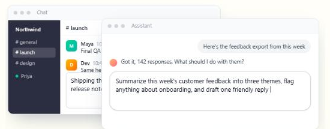
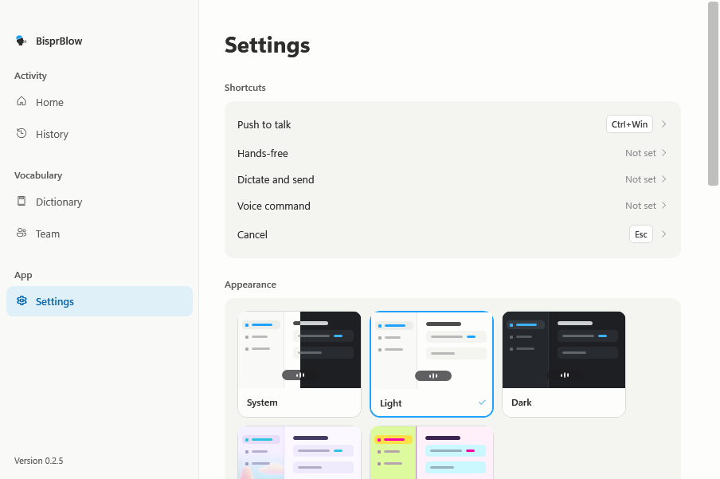

<p align="center">
  
</p>

<h1 align="center">BisprBlow</h1>

<p align="center">Hold a key, say what you mean, and let go.<br>Clean text shows up wherever your cursor is.</p>

<p align="center">
  <a href="https://kalebkim.com/bisprblow">Download</a> ·
  <a href="https://github.com/khicken/bispr-blow/releases">Releases</a>
</p>

<p align="center">
  
</p>

## What it does

BisprBlow turns your voice into writing you'd actually send. It listens while you hold the
shortcut, then cleans up the ums, restarts and run-on sentences before typing the result for you.
It works in any app that takes text, from a chat box to a terminal.

Everything happens on your own computer. Your audio never leaves the machine, and it keeps working
with the wifi off.

## How to use it

Hold **fn** on a Mac, or **Ctrl+Win** on Windows, and start talking. Let go when you're done.

Double-tap the same shortcut to keep listening hands-free, and press **Esc** if you change your
mind. Every shortcut can be changed in Settings.

<p align="center">
  
</p>

A few things worth knowing:

- **Teach it your words.** Names and jargon go in the Dictionary, so they come out spelled right.
- **Everything is saved.** History keeps each dictation, and clicking one copies it again.
- **Pick a look.** There are five themes, including one that is deliberately a bit much.

## Install

Grab the latest build from the [download page](https://kalebkim.com/bisprblow). The Mac app
needs an M-series Mac on macOS 26, and the Windows app runs on Windows 10 or 11.

### Build it yourself

On a Mac, you need the Xcode command line tools. The script downloads about 1 GB the first time,
mostly the model that tidies up your words.

```bash
git clone https://github.com/khicken/bispr-blow
cd bispr-blow
./build.sh
```

On Windows, install the .NET 10 SDK and run the build script from PowerShell.
[windows/README.md](windows/README.md) has the details.

```powershell
git clone https://github.com/khicken/bispr-blow
cd bispr-blow
.\windows\build.ps1
```

## Found a bug?

Open an issue with what you said and what showed up instead. That's usually enough to fix it.
